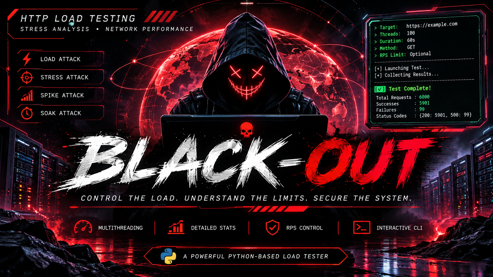

<h1 align="center">☠️ BLACK-OUT</h1>

<h3 align="center">HTTP LOAD TESTING • STRESS ANALYSIS • NETWORK PERFORMANCE</h3>

<p align="center">
  
  
  
  
</p>

<p align="center">
  <i>"Every system has a breaking point. Understanding its limits is the first step toward securing it."</i>
</p>

---

## ⚡ OVERVIEW

**BLACK-OUT** is a Python-based HTTP load-testing utility designed for controlled network performance experiments and authorized infrastructure testing.

Powered by multithreading and configurable request execution, BLACK-OUT enables security researchers, developers, and infrastructure administrators to observe how HTTP endpoints respond under varying request loads.

Its interactive terminal interface provides configurable testing parameters, HTTP method selection, optional request throttling, and basic response statistics.

### 🧬 CORE FEATURES

| Feature | Description |
|---|---|
| Multithreading | Concurrent HTTP request execution |
| GET Requests | HTTP GET request testing |
| POST Requests | Custom POST payload support |
| Configurable Threads | Define worker concurrency |
| Duration Control | Configure test duration |
| RPS Throttling | Optional per-worker request delay |
| Response Tracking | HTTP status code collection |
| Success / Failure Stats | Basic execution statistics |
| Interactive CLI | Menu-driven terminal interface |
| Spike Mode | Two-stage burst-style workload |

---

## 🖥️ TESTING MODES

**01. LOAD TEST**

Execute concurrent HTTP requests against an authorized endpoint to observe its response under a configured workload.

**02. STRESS TEST**

Run a higher-concurrency workload to examine application behavior under increased request pressure.

**03. SPIKE TEST**

Execute a two-stage burst-style workload, initially using double the configured concurrency, followed by the configured concurrency.

**04. SOAK TEST**

Run a sustained request workload for a specified duration to observe response behavior over time.

> **Implementation note:** Load, Stress, and Soak currently share the same underlying execution logic. Spike uses a separate two-stage execution pattern. These modes do not yet implement distinct workload algorithms.

---

## ⚙️ REQUIREMENTS

- Python 3.8+
- pip package manager
- `requests` Python library
- Network connectivity to the authorized testing endpoint

---

## 🚀 INSTALLATION

### 1. Clone the repository

```bash
git clone https://github.com/YOUR_USERNAME/Black-Out.git
```

### 2. Navigate to the project directory

```bash
cd Black-Out
```

### 3. Install dependencies

```bash
python3 -m pip install requests
```

Alternatively, use a virtual environment:

```bash
python3 -m venv venv
source venv/bin/activate
pip install requests
```

### 4. Launch BLACK-OUT

```bash
python3 Black-Out.py
```

---

## 🎮 USAGE

After launching the program, the interactive terminal menu appears:

```text
Select Attack Type:

  1) Load Attack
  2) Stress Attack
  3) Spike Attack
  4) Soak Attack
  5) Exit

Enter choice:
```

### Configuration

The program requests the following parameters:

| Parameter | Description |
|---|---|
| Target URL | Authorized HTTP endpoint |
| Concurrency | Number of worker threads |
| Duration | Test duration in seconds |
| HTTP Method | GET or POST |
| POST Payload | Custom form-style payload |
| Throttle RPS | Optional per-worker request delay |

### Example configuration

For a controlled local laboratory endpoint:

```text
Enter choice: 1

Target URL: http://127.0.0.1:8080
Concurrency (threads): 5
Duration (seconds): 10
HTTP Method (GET/POST) [default: GET]: GET
Throttle RPS (Requests/sec) [optional]: 1
```

### POST request example

```text
HTTP Method (GET/POST) [default: GET]: POST

Payload for POST:
username=test&status=active
```

### Example execution output

```text
Test complete:

Total Requests:  100
Successes:       95
Failures:        5
Status codes:    {200: 95, 500: 5}
```

*Example output is illustrative. Actual results depend on the endpoint and network conditions.*

---

## 🧠 EXECUTION WORKFLOW

```text
        ┌──────────────────────┐
        │     BLACK-OUT CLI    │
        └──────────┬───────────┘
                   │
        ┌──────────▼───────────┐
        │ Testing Configuration│
        │ URL / Threads / Time │
        └──────────┬───────────┘
                   │
        ┌──────────▼───────────┐
        │      Task Queue      │
        └──────────┬───────────┘
                   │
        ┌──────────▼───────────┐
        │    Worker Threads    │
        └──────────┬───────────┘
                   │
        ┌──────────▼───────────┐
        │    HTTP GET / POST   │
        └──────────┬───────────┘
                   │
        ┌──────────▼───────────┐
        │ Response Collection  │
        └──────────┬───────────┘
                   │
        ┌──────────▼───────────┐
        │  Terminal Statistics │
        └──────────────────────┘
```

---

## 🛡️ SECURITY & LEGAL DISCLAIMER

**BLACK-OUT IS PROVIDED STRICTLY FOR AUTHORIZED TESTING, EDUCATIONAL PURPOSES, AND CONTROLLED PERFORMANCE EVALUATION.**

By downloading, installing, or using this software, you acknowledge and agree that:

1. You must own the target infrastructure or have explicit authorization from its owner before conducting any testing.
2. You must comply with all applicable cybersecurity laws, regulations, contractual obligations, and acceptable-use policies.
3. You must not use this software to disrupt services, overload third-party infrastructure, interfere with business operations, or conduct unauthorized denial-of-service activities.
4. All testing must remain within approved traffic limits, authorized scopes, and agreed testing windows.
5. You are solely responsible for your actions and for any consequences resulting from the use or misuse of this software.

**The developer assumes no responsibility or liability for unauthorized activities, misuse, service interruptions, infrastructure damage, financial losses, or legal consequences arising from the use of this project.**

This disclaimer does not grant permission to test any system.

### ⚠️ Technical safety limitations

The current implementation does not enforce:

- Target-domain allowlisting.
- A global request-rate ceiling.
- A hard maximum concurrency limit.
- Automatic protection against excessive traffic.

The optional RPS throttle applies independently to each worker, not globally. Consequently, aggregate request rates may exceed the configured value.

Use an isolated laboratory or explicitly authorized environment. Do not assume that a low RPS setting guarantees safe aggregate traffic.

---

## 🔬 DEVELOPMENT ROADMAP

Potential future improvements:

- [ ] Global RPS enforcement
- [ ] Target allowlisting
- [ ] Maximum concurrency safeguards
- [ ] Live terminal monitoring
- [ ] Response latency measurement
- [ ] Average response-time calculation
- [ ] Latency percentiles (P50 / P90 / P99)
- [ ] Exportable testing reports
- [ ] Improved workload profiles
- [ ] Configuration file support

---

## 👨‍💻 CONTRIBUTIONS

Contributions, suggestions, bug reports, and improvements are welcome.

1. Fork this repository.
2. Create a feature branch.
3. Implement your changes.
4. Submit a pull request.

Please maintain the project's focus on authorized testing and responsible security research.

---

## 📜 LICENSE

Specify a license in the repository before distributing this project.

Unless a license is explicitly provided, all rights remain with the copyright holder. No permission to redistribute, modify, or commercially exploit the software should be assumed.

---

<p align="center">

### ☠️ BLACK-OUT

**CONTROL THE LOAD. UNDERSTAND THE LIMITS. SECURE THE SYSTEM.**

<i>Built for controlled experiments. Designed for security awareness.</i>

</p>
